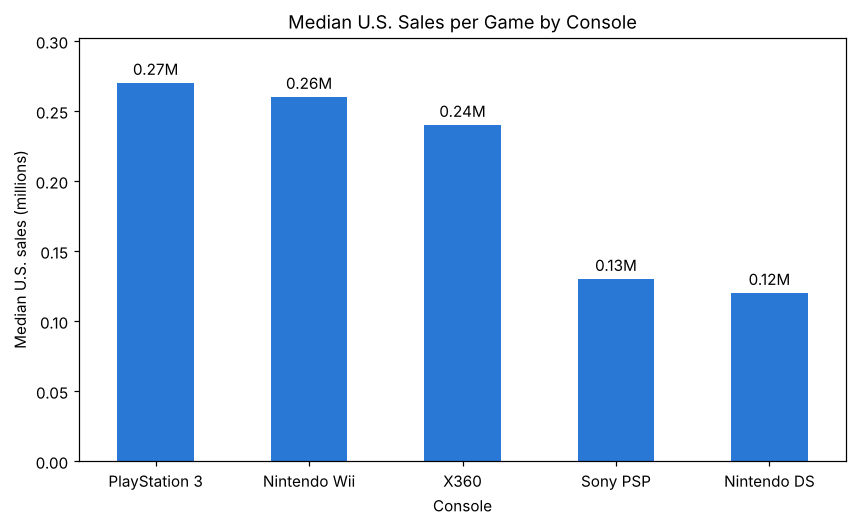

# U.S. Video Game Sales by Console: Mean vs. Median

**Which console's games sell best in the U.S.? It depends on which "average" you trust.** An exploratory analysis of 1,770 games across five consoles.

*Jai Sivaya & Liam Patel · STAT 207 (Data Science Exploration), University of Illinois Urbana-Champaign · Spring 2026*

## Findings

| Console | Games | Mean sales / game | Median sales / game |
|---|---:|---:|---:|
| Nintendo Wii | 296 | **0.69M** | 0.26M |
| Xbox 360 | 437 | 0.55M | 0.24M |
| PlayStation 3 | 312 | 0.46M | **0.27M** |
| Nintendo DS | 418 | 0.45M | 0.12M |
| Sony PSP | 307 | 0.24M | 0.13M |

- U.S. sales per game are **heavily right-skewed**: most games sell under 0.5M copies, while a few blockbusters reach almost 15M.
- The **Wii leads on mean but not median**. A handful of hits inflate its average, so the **PS3 has the strongest *typical* game**.
- **Business takeaway:** when a few outliers dominate, the median is the better guide to what a typical release can expect, which matters for decisions like platform selection or forecasting.

## Files

| File | Description |
|---|---|
| [`video_game_sales_by_console.ipynb`](video_game_sales_by_console.ipynb) | Data cleaning, grouped summary statistics, log-scale box plots, median comparison |
| `video_games.csv` | 1,770 games with console, title, U.S. sales (millions) and release year, provided for the course project |

**Tools:** Python · pandas · Matplotlib
